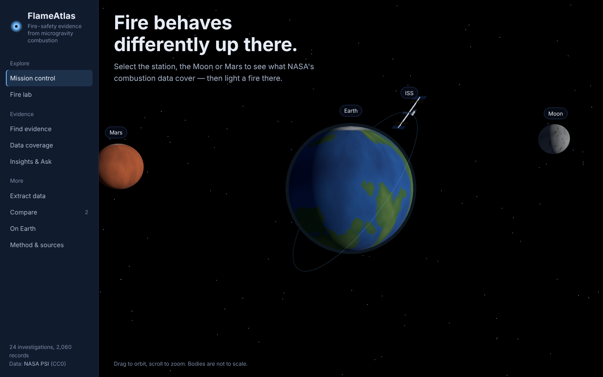
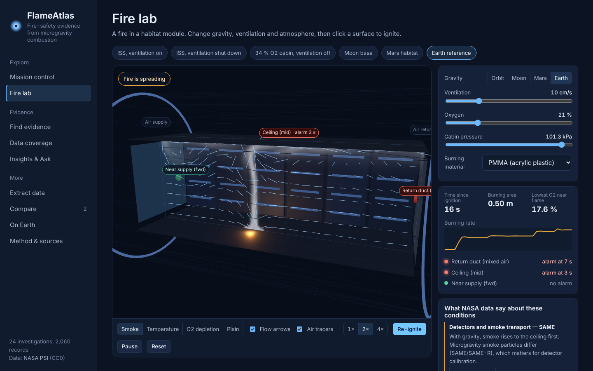
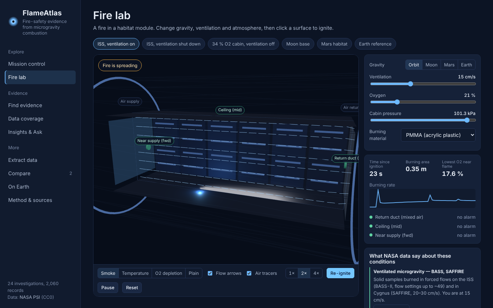
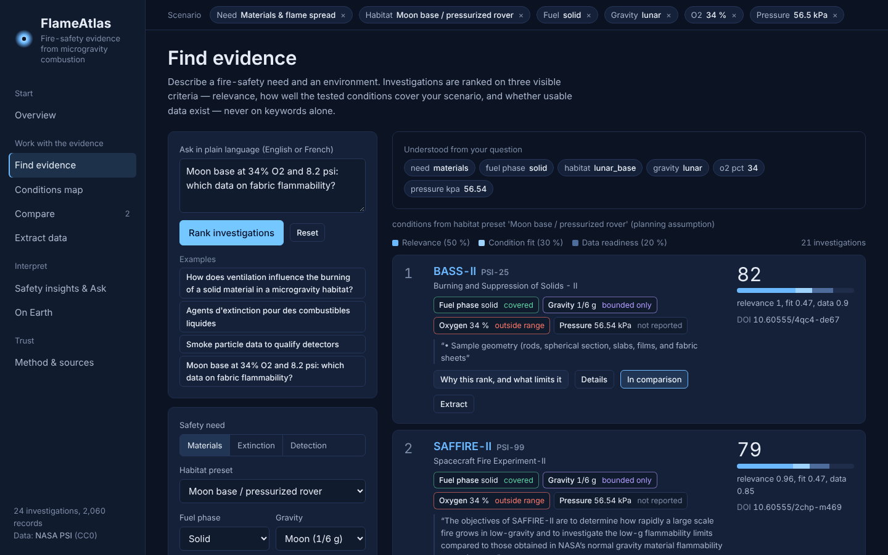
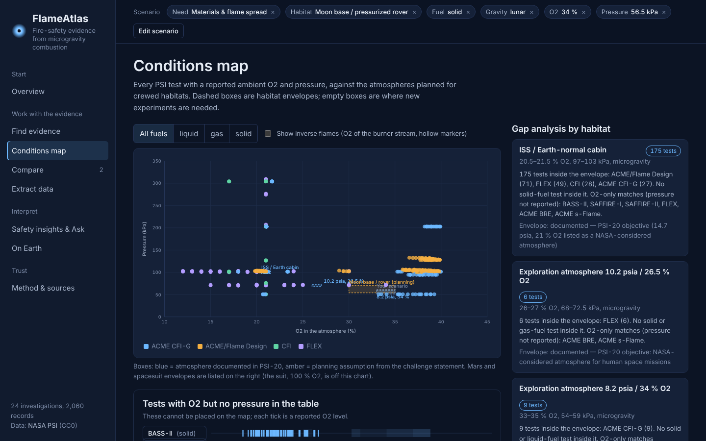
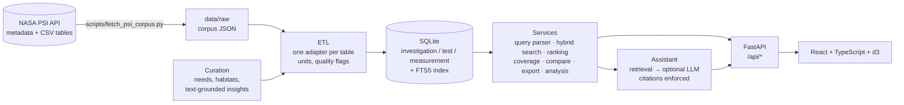

# FlameAtlas

**Fire-safety evidence from NASA microgravity combustion data.**
NASA Space Apps Challenge 2026 — *Flame in Freefall: SI-powered fire safety insights from microgravity combustion data.*

FlameAtlas turns the combustion investigations of NASA's [Physical Sciences Informatics (PSI)](https://psi.nasa.gov/physci/repo/search?q=combustion) repository into answers an engineer can act on:

- **which experiments matter** for a given fire-safety need and habitat,
- **what their tested conditions actually cover** — and where the evidence stops,
- **modelling-ready data**, with every value traceable to its NASA file, row and DOI.



---

## Three experiences on top of the evidence

**Mission.** Earth, the ISS, the Moon and Mars rendered from real NASA data (Blue Marble, LRO LROC, Viking MDIM 2.1, NASA's 3-D ISS model). Click a body: its gravity and cabin air, what NASA's combustion data cover there, real NASA photographs of the place, and the fire scenarios you can simulate there. One click (or a double-click on the body) opens that habitat's simulation.

**Fire lab.** A 3-D fire simulation inside four habitats, each with its own geometry, decor and backdrop photograph:
ISS (Node 1 → US Lab → Node 2), a Moon base (lab, crew quarters, airlock), a two-deck Mars habitat, and the ISS mockup at 1 g.

- **Physics**: 3-D low-Mach incompressible Navier–Stokes on the habitat grid with immersed solids (bulkheads, partitions, benches, decks), Boussinesq buoyancy, thermal expansion of burnt gas (∇·u = S), vorticity confinement, MacCormack advection of heat and smoke, transport of O₂, CO₂ and smoke; supply vents and open returns; sealed-cabin pressure rise when the fans stop.
- **Fire**: up to four sources on any surface (click to ignite), material-specific limits, spread (faster downstream and uphill), burnout, radiative-loss extinction; response actions: shut the fans, open/close every hatch and door, discharge a CO₂ extinguisher.
- **Analysis**: ray-marched smoke / heat / CO₂ volume; movable cut planes (temperature, O₂, CO₂, smoke, speed, vorticity, Péclet, pressure) with iso-lines and auto-range; auto-scaled velocity vectors with a reference arrow; streamlines seeded at vents, fire or the plane; air tracers and Lagrangian smoke parcels; zone table (hottest, lowest O₂, smoke); axial or vertical profiles; probe with velocity vector and time series; per-zone smoke alarms; solver diagnostics (CFL, RMS divergence residual, kinetic energy, cabin pressure rise); CSV and PNG export.
- **Navigation**: outside cut-away or walk inside (drag + WASD) with collisions against the same solids the flow sees.

**Knowledge engine.** An Obsidian-style knowledge graph over the whole base: documents (PSI investigations, 367 publications, your uploads), concepts, entities, data (measured quantities, atmosphere envelopes) and findings, linked by ten typed relationships. Every link carries its basis (metadata, passage, table, computed, curated, inferred, wikilink) and its evidence. Ask a question at the bottom: hybrid retrieval (BM25 + TF-IDF + graph) builds the evidence path in the graph and a cited answer; each research is stored and can be reopened. Upload PDF, DOCX, XLSX, CSV, Markdown, TXT, HTML or JSON; export the graph as an Obsidian vault (or write it into `./vault`) and import your own notes with their wikilinks.

The fire model is tuned to reproduce qualitative trends in the PSI data; it is labelled as an educational model, not a validated CFD code. Image and model provenance: [docs/CREDITS.md](docs/CREDITS.md).

| Earth: buoyant plume, ceiling alarm in seconds | Orbit, ventilation on: smoke follows the airflow |
|---|---|
|  |  |

## What it does

The three objectives of the challenge and its Earth add-on each map to a module:

| Challenge objective | FlameAtlas module | What you get |
|---|---|---|
| Identify investigations most relevant to habitable crew environments | **Find evidence**, **Conditions map** | Ranking by need (materials, extinction, detection) and scenario (ISS, exploration atmospheres, Moon base, Mars), with three visible scores and a per-condition explanation |
| Extract data that supports predictive modelling | **Extract data**, **Compare** | A unified table of 2,060 records / 7,688 measurements across 24 investigations, filtered and exported as a ZIP with data dictionary, provenance and limitations |
| Highlight research that informs next-generation fire-safety controls | **Safety insights & Ask** | Insight cards (observation → design question → limitation → next validation) and a question-answering assistant that cites its sources |
| Applications on Earth | **On Earth** | Transfers to submarines, aircraft, mines, smoke detection, fire models, engines — each with the validation still required |

### Findings the data surfaced

All of these are computed from the NASA tables or quoted from PSI records, never typed by hand:

- **Exploration atmospheres are almost untested.** At 8.2 psia / 34 % O2 (a NASA-considered crew atmosphere), PSI holds only 9 tests with both O2 and pressure in range — all gaseous ACME CFI-G flames. None of them uses a solid or liquid fuel.
- **More oxygen, fewer self-extinctions.** In FLEX (N2-only atmospheres), methanol flames went out before burnout in 9 of 12 tests at 21 % O2, but in only 2 of 13 at 30–34 %. For heptane, the counts are 5 of 17 at 21 % versus 0 of 11.
- **Cutting ventilation may not be enough.** ACME BRE observed flames that emulate burning solids keep burning without airflow in elevated-O2 atmospheres. At 21 % O2, the same flames self-extinguished. PSI flags these results as preliminary.
- **1 g and microgravity can rank materials differently.** In SAFFIRE-II, all four silicone samples barely burned in microgravity at 20 cm/s, while two of the four matching 1-g reference burns were complete.
- **There are no partial-gravity combustion data yet.** FlameAtlas never treats Moon or Mars conditions as microgravity: those results are shown as *bounded only*.

| Ranking with explanations | Coverage map |
|---|---|
|  |  |

---

## Quick start

Requirements: **Python ≥ 3.10**, **Node ≥ 20**.

```bash
make setup      # venv + pip install + npm install
make test       # 31 back-end tests (ETL, ranking criteria, export, assistant, API)
make api        # API on http://localhost:8000  (docs: /docs)
# macOS: or just double-click setup.command once, then start.command
make web        # UI on  http://localhost:5173  (second terminal)
```

Without `make`:

```bash
python3 -m venv .venv && source .venv/bin/activate
pip install -r backend/requirements.txt
cd backend && uvicorn flameatlas.api.main:app --reload --port 8000
# second terminal
cd frontend && npm install && npm run dev
```

The SQLite database is built automatically on first start from `data/raw/psi_combustion_corpus.json` (or explicitly with `make data`).

**Optional language model.** Copy `.env.example` to `.env` and set `ANTHROPIC_API_KEY` (or `OPENAI_API_KEY`). Without a key, *Ask* returns an extractive answer quoted from the sources, and everything else works the same.

**Production / single server.** `make serve` builds the front-end and serves it from the API on port 8000. A `Dockerfile` is included (Render, Railway, Fly.io, Hugging Face Spaces…).

---

## Architecture



| Layer | Choice | Why |
|---|---|---|
| Data store | SQLite + FTS5 | One file, no server, full-text search with BM25, reproducible |
| ETL | Python, one adapter per PSI table | Every PSI table is shaped differently; each adapter records its interpretations as quality flags |
| Search | Rule-based query parser (EN/FR) + BM25 + TF-IDF (word + char n-grams), fused with RRF | Works offline and is explainable |
| Ranking | Deterministic rules: relevance · condition fit · data readiness | Reproducible and defensible — the LLM never scores |
| API | FastAPI + Pydantic | Typed, self-documenting (`/docs`) |
| Assistant | Retrieval + optional Claude / OpenAI, mandatory `[S#]` citations, extractive fallback | Grounded answers that do not depend on the API being up |
| Front-end | React 19, TypeScript, Vite, d3, three.js | Charts drawn from data; 3-D scenes and a real-time fluid solver (`frontend/src/sim/fluid.ts`) |

### Data model

Three levels are kept separate:

- `investigation` — a PSI programme (e.g. FLEX, PSI-69), with its DOI and curated classification.
- `test` — one run, session or test-matrix row, with `source_file` and `source_row`.
- `measurement` — one reported quantity with its unit and `source_column`.

Missing values are `NULL` (never 0). Every interpretation made while parsing is stored in `test.quality`:

| Flag | Meaning |
|---|---|
| `assumed_unit_cm_s` | BASS-II "Air display" assumed to be in cm/s |
| `typo_corrected_percent` | PSI wrote "3400%" for 34 % O2 |
| `typo_corrected_leading_zero` | "037 mm" read as 0.37 mm |
| `o2_is_oxidizer_stream_not_ambient` | Inverse flames: the O2 value is the burner stream, not the cabin atmosphere |
| `unit_inconsistency_across_tables` | SIBAL thickness is 0.37 cm in SAFFIRE-I but 0.37 mm in SAFFIRE-II |

### Ranking rules

`score = 0.5 × relevance + 0.3 × condition fit + 0.2 × data readiness`

- **Relevance**: the curated weight of the selected need for the investigation (shown in the UI), blended with the text match to the question.
- **Condition fit**: computed per factor from the tested ranges in the data:

  | Status | Score |
  |---|---|
  | covered | 1 |
  | close | 0.55 |
  | bounded only (partial gravity) | 0.5 |
  | not reported | 0.3 |
  | outside range | 0.1 |

- **Data readiness**: whether test-level records exist, how many there are, and whether the variables the need requires are present.

Reference criteria are encoded as tests (`backend/tests/test_ranking.py`, `benchmark_questions.json`):

- "materials" brings up solid-fuel studies;
- "liquid extinction" brings up FLEX;
- "smoke detection" brings up SAME-R, in English and in French;
- the Moon is never a microgravity match;
- unknown conditions stay unknown.

---

## API

| Method | Path | Purpose |
|---|---|---|
| GET | `/api/meta` | Counts, build info, needs and pillars |
| GET | `/api/investigations`, `/api/investigations/{PSI-ID}` | Catalogue and detail (profile, variation, publications, insights) |
| GET | `/api/investigations/{PSI-ID}/tests` | Test records with measurements |
| POST | `/api/rank` | Explained ranking for a scenario or a free-text question |
| GET | `/api/search?q=` | Parsed query, passages and ranking |
| GET | `/api/coverage` | Points, habitat envelopes and gap analysis |
| GET | `/api/compare?ids=` | Side-by-side comparison (max 4) |
| POST | `/api/extract/preview`, `/api/extract/export` | Filtered table / ZIP (data, dictionary, provenance, limitations, citations) |
| GET | `/api/analysis/scatter`, `/api/analysis/flex` | Variable-vs-variable plots; FLEX reference analysis |
| GET | `/api/insights`, `/api/earth`, `/api/habitats` | Curated and computed content |
| POST | `/api/ask` | Grounded Q&A with sources |

Interactive documentation is at `http://localhost:8000/docs`.

---

### Knowledge engine endpoints

| Method | Path | What it does |
|---|---|---|
| GET | `/api/kg/overview` · `/api/kg/graph` | Node/edge counts; the aggregated graph (filters: `types`, `rels`, `publications`) |
| GET | `/api/kg/node?id=` · `/api/kg/edge?id=` | Node with incoming/outgoing relationships and passages; edge with definition and evidence |
| POST | `/api/kg/research` | Question → concepts/entities → hybrid retrieval → evidence path + cited answer (stored) |
| GET | `/api/kg/research` · `/api/kg/research/{id}` | Research history; reopen a stored result |
| POST | `/api/kg/ingest` · DELETE `/api/kg/documents/{id}` | Add documents (base64 JSON; dedup by SHA-256, versioning by filename) · remove one |
| GET | `/api/kg/obsidian/export` · POST `/api/kg/obsidian/sync` · POST `/api/kg/obsidian/import` | Vault zip · write the vault into a local folder · import Markdown notes or a zipped vault |

## Repository layout

```
backend/
  flameatlas/
    etl/          parsing.py, adapters.py (one per PSI table), curation.py, build.py
    services/     query_parser, search, ranking, coverage, compare, export, analysis, assistant, llm
    api/main.py   FastAPI app (also serves frontend/dist in production)
  tests/          pytest suite + benchmark questions
frontend/         React + TypeScript + d3 (Vite)
data/
  raw/            psi_combustion_corpus.json  (NASA PSI, CC0-1.0)
  processed/      flat CSV copies of the database, for review
scripts/          fetch_psi_corpus.py — re-download the corpus from PSI
docs/             screenshots, demo script
```

---

## Data, citation and limits

- **Source.** NASA PSI repository, retrieved through its public API, together with each investigation's experimental-table CSV files. The data are released under **CC0-1.0**. NASA asks that every dataset be cited by its **DOI**; DOIs appear on every card, in every export and in `CITATION.txt`.
- **Scope.** All 24 combustion-science investigations returned by PSI, plus two keyword matches that are kept but marked out of scope (PSI-181 solders, PSI-108 thermocapillary flow).
- **Limits.**
  - Summary tables do not contain many results (spread rates, particle sizes, temperature fields) that exist only in raw PSI files.
  - All flight data are microgravity.
  - The Moon and Mars envelopes are planning assumptions taken from the challenge statement and from PSI-20.
  - Fits are descriptive and valid only inside the measured range.
  - FlameAtlas does not predict whether a given material will burn.

## Use of AI

This project was built with the help of an AI coding assistant.

In the product, an optional language model only rephrases passages and numbers that the application has already retrieved and computed, and its citations are checked against the sources it was given. All rankings, statistics, unit conversions and exports are deterministic Python. The Flame Lab animation is a labelled schematic, not a simulation.

## License

Code: MIT. NASA PSI data: CC0-1.0 (cite DOIs).
